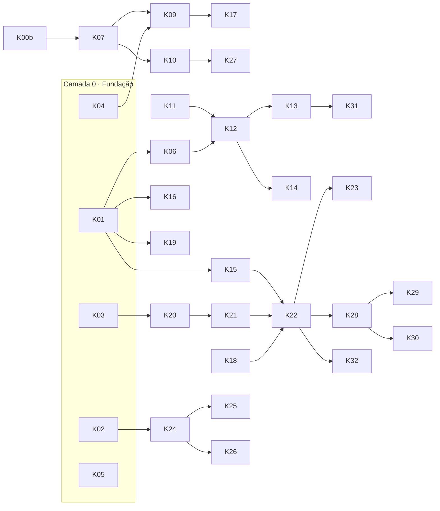

# Kanban — Torralles Studio

> Atualizado em 21/11/2026. Cada cartão aponta para a spec que o define (`docs/sdd/`).
> Fluxo de cada cartão: **Backlog → Especificado → Em andamento → Em verificação → Pronto**.

## Regras do quadro
- **Pronto para começar** (Especificado): tem spec, critérios de aceite e dependências resolvidas.
- **Pronto de verdade** (Pronto): testes passando, critérios de aceite cumpridos e **verificado por um agente diferente de quem fez** (protocolo, fase 7). Reprovado → volta para "Em andamento" com o feedback.
- **No máximo 3 cartões em andamento** ao mesmo tempo; cartões da mesma camada sem dependência entre si podem rodar em paralelo.
- Bloqueios ficam marcados com 🔒 e o que falta.
- Toda decisão nova vai para `docs/sdd/decisoes.md`; aprendizados de cada fase vão para o Cérebro (D16).

---

## ✅ Pronto
| ID | Cartão | Spec |
|---|---|---|
| K00a | Roteador com fallback por função, provedores e CLI (protótipo) | — |
| K34 | Cotas gratuitas que duram entre execuções (tabela `cotas`, UTC no banco, Brasília na tela; cota esgotada só por padrão declarado ou Retry-After > 1 h), licença por modalidade no perfil (D24), tarefa `video` renomeada para `animar` (apelido mantido) e comando `cotas`; verificado por agente e corrigido | [14](docs/sdd/14-fila-gratuita-midia.md) · D24 |
| K35 | Prompts por serviço (`prompts_midia.py`, moldes em `config/prompts_midia.toml`): cada serviço recebe o prompt no formato dele; checagem por regra antes de gastar cota (texto pedido na imagem, nomes que o perfil evita, campos, limite, movimento); Ken Burns nunca barrado; comando `prompt-midia` | [14](docs/sdd/14-fila-gratuita-midia.md) |
| K36 | Cloudflare Workers AI (FLUX schnell, 10.000 neurons/dia, uso comercial) na cadeia `imagem`; termos de 17 serviços conferidos; Pollinations fora (marca d'água vista na imagem real, termos não abriram) — falta a chave grátis do Diego | [14](docs/sdd/14-fila-gratuita-midia.md) · D24 |
| K37 | Sites grátis no navegador do Claude: skill `midia-navegador`, `pedidos-navegador`, `importar-midia` (tipo pelos bytes, tamanho antes de abrir, só a pasta do pedido, licença do config), fila `[sites.*]` com 9 sites (hoje entra só o Adobe Firefly) — teste real pendente (logins do Diego) | [14](docs/sdd/14-fila-gratuita-midia.md) · D24 |
| K38 | Juiz de visão nas imagens (`[avaliacao.imagem]`, cadeia `juiz_imagem`, família diferente de quem gerou); reprovada, refaz uma vez com a correção e fica a melhor; sem juiz, fica "revisar" — teste real pendente (chave com visão) | [03](docs/sdd/03-parametros-avaliacao.md) · [14](docs/sdd/14-fila-gratuita-midia.md) |
| K39 | Transcrição grátis no PC (faster-whisper, modelo small) antes do Gemini: conferência da narração, percepção e tempo de cada palavra; conferência local não entra no orçamento; áudio lido pelo FFmpeg do Studio (D25) | D25 |
| K46 | Skills de motion graphics só no Studio (`.claude/skills`, nível do projeto): motion-design (LottieFiles `2e1f3c0`, MIT), 8 do GSAP (`aed9cfd`, MIT), 13 do Remotion (`6f55706`) e 6 do HyperFrames (v0.9.69 `3229c3a`, Apache-2.0); projetos de teste em `motion/` (Remotion 4.0.545 e HyperFrames 0.9.69, versões exatas); teste de 10 s em 1080x1920 renderizado nos dois. Ficam fora do Git: `node_modules/`, `.hyperframes/`, `.claude/fontes-motion/` e os vídeos (`saidas/`) | D27 |
| K43 | Painel do Studio no navegador (`python -m torralles_studio servidor` → `http://127.0.0.1:8765/`): projetos e pedidos, vídeo, cenas (imagem, trecho, fala, fonte e licença), capa, post, créditos e régua; aprovar ou pedir alteração com comentário por item (tabela `revisoes`); pedido novo; biblioteca; controle (provedores, cotas, fila, gasto). Só biblioteca padrão, sem CDN, CSP só `'self'`, arquivos por lista fechada, token por cookie HttpOnly. Refazer sozinho o item com alteração pedida fica para a etapa 2 (K44) | [15](docs/sdd/15-painel.md) |
| K42 | Voz Kokoro-82M em português no PC, grátis, última reserva da cadeia de voz (pf_dora e pm_alex com 0% de erro na frase de lh/nh/rr); roda em processo separado porque o fonemizador é GPL-3 (D26); conferência da voz aceita hífen junto ou separado | D26 |
| K41 | Legenda karaokê no tempo real de cada palavra: tempo do Whisper alinhado ao texto do roteiro (palavra falada diferente, como "30"/"trinta", fica entre as vizinhas), guardado em `voz_XX.palavras.json` para a retomada; sem Whisper ou com fala que não bate, vale a estimativa; regras de leitura da legenda mantidas | D25 · [03](docs/sdd/03-parametros-avaliacao.md) |
| K40 | Vídeo de banco grátis (Pexels/Pixabay, uso comercial) nas cenas antes da imagem de IA: só clipe que combina com a cena, cortado no formato e na duração da fala, com licença e crédito; liga sozinho quando houver a chave — falta `PEXELS_API_KEY`/`PIXABAY_API_KEY` do Diego | D25 · [11](docs/sdd/11-banco-midia-gratuita.md) |
| — | Capa com título (`capa.jpg`) e texto para postar (`post.txt`: título, descrição, hashtags, créditos), ideia tirada dos concorrentes | — |
| — | Auditoria geral de 17/11 (5 agentes) corrigida: config lido em UTF-8 (acentos chegavam errados aos juízes), FFmpeg sempre com prazo e UTF-8 (`ff.py`), servidor aprova/cancela e recusa JSON malicioso, um processo por pasta de pedido, juiz com evidência no feedback e temperatura, fatos com "N por cento", retomada refaz vídeo velho e não aceita voz muda, perfil não afrouxa licença | — |
| K00b | Percepção níveis 1 e 2: quadros, cortes, som, transcrição com fallback | [10](docs/sdd/10-percepcao.md) |
| K06 | Juiz que assiste o vídeo inteiro (Gemini, vídeo + áudio, também por link do YouTube) — teste real no PC em 18/10: nota 90/100 no vídeo de demonstração | [10](docs/sdd/10-percepcao.md) |
| K21 | Trilha pelo clima do roteiro (`trilha.py`): música instrumental com licença comercial, BPM e energia medidos com FFmpeg, voz eliminatória, crédito; trilha ruim nunca derruba o vídeo; efeitos curtos nos cortes pelo clima, do acervo local (`efeitos.py`, `importar-sons`), 15 LU abaixo da voz — teste real no PC pendente (Jamendo) | [12](docs/sdd/12-pesquisa-qualidade-concorrentes.md) · D19 |
| K23 | Exportação para o CapCut (`exportar.py`, `produzir --capcut`, `exportar-capcut`): clipes por quadros, áudios alinhados no volume do vídeo, legenda .srt, guia e créditos — abrir no CapCut no PC pendente | D5 |
| K28 | Servidor do Studio para o Ops e o Hermes: contrato da spec 08, fila assíncrona no SQLite (sem produção em dobro, retomada de órfãos, teto nas retomadas), HTTP local protegido (CSRF, host, token) e MCP por stdio — teste real com o Ops/Hermes pendente | [08](docs/sdd/08-contrato-ops-studio.md) · D13 · D14 |
| K18 | Voz com fallback (voz do Gemini antes do Edge) e conferência da narração por transcrição (erro de palavras ≤ 10%, números por extenso, refaz com outra voz e fica com a melhor, dentro do teto); `testar-voz` — teste real no PC pendente (nome do modelo TTS) | [11](docs/sdd/11-banco-midia-gratuita.md) |
| K12 | `analisar-referencia` (`referencias.py`): métricas, estrutura do roteiro, tipo de gancho, 4 critérios de potencial com evidência e âncoras sugeridas; link do YouTube sem baixar, arquivo local medido pelo FFmpeg; JSON em `dados/referencias/` — teste real no PC pendente | [12](docs/sdd/12-pesquisa-qualidade-concorrentes.md) · [09](docs/sdd/09-referencias-qualidade.md) |
| K13 | Perfil de referência por categoria (`perfil-referencia -c A --salvar`): faixa 25º–75º das referências positivas (negativas ficam fora), tipos de gancho, potencial mínimo; vídeo fora da faixa da categoria do perfil ganha alerta no relatório — gerar `config/perfis_referencia.toml` com as análises reais no PC pendente | [09](docs/sdd/09-referencias-qualidade.md) |
| K14 | Calibração (`nota-referencia`, `calibrar`): suas notas 0–10 × notas do juiz por critério e por juiz (generoso, rígido, discorda muito) com recomendação; âncoras aprovadas em `config/ancoras.toml` entram no prompt da análise; reanálise mantém suas notas — suas notas nas referências (PC) pendentes | [03](docs/sdd/03-parametros-avaliacao.md) · [09](docs/sdd/09-referencias-qualidade.md) |
| K31 | Benchmark prático (`benchmark` com `briefings`, `produzir`, `dados` e `avaliar`): os 3 briefings da spec 04, vídeos do Studio com um teto por vídeo, dados anotados à mão das outras ferramentas, mesma régua para todos (checagens do FFmpeg + mesmo juiz) e relatório comparativo (`--doc` grava a 04b) — rodar no PC e gerar os vídeos nas outras ferramentas pendente | [04](docs/sdd/04-benchmark.md) |
| K00c | Planejamento: specs 00–12 e decisões D1–D20 | [decisões](docs/sdd/decisoes.md) |
| K01 | Modelos atualizados + Kling v3 `start_image_url` (teste de contrato por família) | [00](docs/sdd/00-descoberta.md) |
| K02 | Pacote renomeado para `torralles_studio` | D1 |
| K03 | Downloads seguros: domínios permitidos, redirecionamento conferido antes de seguir, limite de tamanho e prazo total | [05](docs/sdd/05-dados-seguranca-memoria.md) · D8 |
| K04 | Chaves mascaradas + teto de custo de US$ 1,50 | D8 · D20 |
| K05 | `CLAUDE.md` do projeto | [05](docs/sdd/05-dados-seguranca-memoria.md) |
| K07 | Avaliador na régua 0–100: eliminatórios, pesos, pisos, juízes de outra família, desempate | [03](docs/sdd/03-parametros-avaliacao.md) · D15 |
| K08 | Checador de fatos travados (preço, link, percentual, obrigatórios) | [08](docs/sdd/08-contrato-ops-studio.md) · D15 |
| K10 | Relatório de qualidade e custo por peça (JSON) | [01](docs/sdd/01-controle-qualidade.md) |
| K09 | Loop de correção: refaz só a peça, feedback delimitado, limites, teto de custo, melhor tentativa | [01](docs/sdd/01-controle-qualidade.md) |
| K24 | SQLite: projetos, peças, tentativas, avaliações, custo; retomada sem pagar de novo e cache | [05](docs/sdd/05-dados-seguranca-memoria.md) · D6 |
| K26 | Perfis por projeto que não se misturam (estilo, voz, formato, kit visual, memória; ligação com o Hermes) | D11 · D13 |
| K25 | Biblioteca de mídia por hash, licença obrigatória, busca por etiqueta, procedência e etiquetas por perfil | [05](docs/sdd/05-dados-seguranca-memoria.md) · [11](docs/sdd/11-banco-midia-gratuita.md) |
| K15 | Roteiro em JSON com clima e sons por cena (esquema + régua + fatos travados + perfil) | [03](docs/sdd/03-parametros-avaliacao.md) |
| K16 | Pesquisa com fontes delimitadas e citações sempre conferidas (2 domínios) | [03](docs/sdd/03-parametros-avaliacao.md) |
| K27 | Aprendizados de produção para o Cérebro (só tentativas julgadas; instruções positivas com números) | D16 |
| K11 | Canais de referência: lista base aprovada, categoria A completa (`config/referencias.toml`); C, D e F aguardam suas indicações | [09](docs/sdd/09-referencias-qualidade.md) · D17 |
| K20 | Mídia gratuita em 3 camadas com licença por arquivo (Freesound só em projetos não comerciais, D22) — teste real pendente com as chaves | [11](docs/sdd/11-banco-midia-gratuita.md) · D18 · D22 |
| K22 | Montagem final (`montagem.py`, comando `montar`): tempo da fala, cortes na batida, legendas sincronizadas na área segura, trilha 12 LU abaixo da voz, −14 LUFS e conferência automática. A escolha da trilha (K21) e a voz com fallback (K18) entram depois | [03](docs/sdd/03-parametros-avaliacao.md) · [12](docs/sdd/12-pesquisa-qualidade-concorrentes.md) |

## 🔍 Em verificação
| ID | Cartão | Spec |
|---|---|---|

## 🛠️ Em andamento
| ID | Cartão | Spec |
|---|---|---|
| K33 | CapCut operado pelo Claude no navegador do Claude: skill `capcut-navegador` (montagem + acabamento no CapCut web, login e aprovação do Diego, só mídia do Studio) e `linha_do_tempo.json` com clima, narração, texto na tela, título, CTA e créditos; verificado por agente e corrigido — teste real no PC pendente | [13](docs/sdd/13-capcut-navegador.md) · D23 |
| K32 | Primeiro vídeo real ponta a ponta: comando `produzir` (pesquisa → roteiro com juiz → imagem, voz e cena → montagem, com retomada; foto gratuita com licença quando a IA de imagem falha). Rodou no PC em 21/10: "não ficou tão ruim, faltam animações e efeitos". Feito depois: legenda palavra por palavra, título animado, transição pelo clima, movimento com aceleração suave e efeitos por clima. Falta: trilha e efeitos sonoros (K21) e sua aprovação | D19 |

## 📋 Especificado (pronto para começar)

### Camada 0 — Fundação
✅ Concluída em 16/10/2026 (verificada por agente independente; ver `docs/sdd/aprendizados.md`).

### Camada 1 — Qualidade (depende da Camada 0)
K07–K10 prontos em 16/10/2026. Falta só o K06 (roda no PC, com a chave do Gemini).

| ID | Cartão | Spec | Depende de | Critérios de aceite |
|---|---|---|---|---|

### Camada 2 — Referências (D17; corre em paralelo à Camada 1)
| ID | Cartão | Spec | Depende de | Critérios de aceite |
|---|---|---|---|---|

### Camada 3 — Produção (depende das Camadas 0 e 1)
| ID | Cartão | Spec | Depende de | Critérios de aceite |
|---|---|---|---|---|
| K17 | 🔒 Imagens com consistência entre cenas (Nano Banana 2 / FLUX) | [03](docs/sdd/03-parametros-avaliacao.md) | K01 · K09 · **chaves** | Juízes aprovam consistência e anatomia |
| K19 | Vídeo por cena no modo misto (Kling v3 nas cenas-chave, zoom nas demais) — zoom local já segue a proporção do perfil e o movimento da cena (17/10) | D20 | K01 · K04 · chave fal.ai ✅ (21/11: `FAL_KEY` no `.env`; Kling animou 5 s da cena do chá verde) | Custo dentro do teto; sem congelamento indevido |

### Camada 4 — Dados e memória (pode começar junto com a Camada 1)
✅ Concluída em 16/10/2026 (K24–K27).

| ID | Cartão | Spec | Depende de | Critérios de aceite |
|---|---|---|---|---|

### Camada 5 — Integração (depende das Camadas 1, 3 e 4)
| ID | Cartão | Spec | Depende de | Critérios de aceite |
|---|---|---|---|---|
| K29 | No Torralles Ops (outro repositório): botão "Produzir no Studio" + colunas novas | [08](docs/sdd/08-contrato-ops-studio.md) | K28 | Peça volta com arquivo, nota e custo |
| K30 | Hermes: skill/perfil que chama o Studio | [06](docs/sdd/06-estudo-hermes.md) | K28 | Pedido pelo Hermes gera vídeo |

### Camada 6 — Validação
| ID | Cartão | Spec | Depende de | Critérios de aceite |
|---|---|---|---|---|
| K32 | Primeiro vídeo real ponta a ponta, **aprovado por você** | D19 | K22 · K09 | Você aprova o vídeo completo |

### Camada 8 — Painel (spec 15)
| ID | Cartão | Spec | Depende de | Aceite |
|---|---|---|---|---|
| K44 | Refazer pelo painel só o item com alteração pedida (uma cena, a voz, a trilha, a capa ou o post), usando o comentário como correção e sem pagar de novo o resto; marca a revisão como atendida | [15](docs/sdd/15-painel.md) | K43 | Pedir alteração na cena 2 do chá verde troca só a cena 2 e remonta o vídeo |
| K45 | Anúncios (chamada para ação, formatos por plataforma, cuidado com promessas) como novo tipo de peça no painel | — | K43 | Spec própria aprovada pelo Diego |

### Camada 9 — Acervo de mídia para os agentes (spec 16, ⏳ proposta aguardando o Diego)
| ID | Cartão | Spec | Depende de | Aceite |
|---|---|---|---|---|
| K47 | Taxonomia (tipo, clima, energia, BPM, duração, loop, orientação), medidas guardadas e `importar-acervo` | [16](docs/sdd/16-acervo-midia.md) | — | 10 trilhas da Pixabay importadas com medidas; `acervo buscar --clima calmo` acha as calmas |
| K48 | Busca para agentes: `acervo buscar --json`, `acervo usar --para`, MCP `buscar_midia`, filtros no painel | [16](docs/sdd/16-acervo-midia.md) | K47 | Teste do Remotion montado com trilha e efeito do acervo e `creditos.txt` certo |
| K49 | `produzir` usa sonoplastia pelos "sons" do roteiro e ambiente por cena | [16](docs/sdd/16-acervo-midia.md) | K47 | Vídeo de teste com trilha, efeitos e som de ação no tempo certo |
| K50 | Primeiro acervo com o Diego (~20 trilhas, ~40 efeitos, ~20 sonoplastias e ambientes) | [16](docs/sdd/16-acervo-midia.md) | K47 · termos conferidos | `acervo` lista itens com licença e medidas |

### Camada 7 — Fila gratuita de imagem e vídeo (D24)
✅ K34–K38 prontos em 17/11/2026 (verificados por agentes independentes). Testes reais dependem do Diego (veja
"Bloqueios atuais").

## 🔁 Recorrentes
| ID | Cartão | Frequência |
|---|---|---|
| KR1 | Verificar modelos, preços e limites gratuitos dos provedores (última: 24/10/2026, `docs/sdd/revisao-modelos.md`) | Mensal |
| KR2 | Recalibrar juízes ao trocar um modelo ou a cada mês | Mensal |

---

## Ordem e paralelismo

## Bloqueios atuais
| O que falta | Destrava |
|---|---|
| Teste real com `GEMINI_API_KEY` no PC (`.env`; os segredos da nuvem não servem ao Gemini) | K06, K12, K21 (ouvir trilhas) |
| Suas indicações de canais para as categorias C, D e F (`config/referencias.toml`) | K12–K14 nessas categorias (a A já pode seguir) |
| Chaves de produção (ElevenLabs; fal.ai ✅ em 21/11, DeepSeek e Tavily já prontas) | K16–K19 com provedores reais |
| Chaves grátis do Pexels e da Pixabay (`PEXELS_API_KEY`, `PIXABAY_API_KEY`) | K40: vídeo de banco nas cenas (e fotos melhores que as do Openverse) |
| Chave grátis da Cloudflare (`CLOUDFLARE_ACCOUNT_ID` e `CLOUDFLARE_API_TOKEN` no `.env`) | K36: imagem grátis com uso comercial (a Pollinations saiu por marca d'água) |
| Chave com visão (`ANTHROPIC_API_KEY` + `CLAUDE_MODEL`, ou OpenAI, ou o Gemini pago) | K38: nota do juiz nas imagens (sem ela, as imagens ficam "revisar") |
| Seus logins nos sites (Adobe Firefly primeiro) e leitura dos termos dos sites `a_conferir` | K37: teste real com a skill `midia-navegador` |
