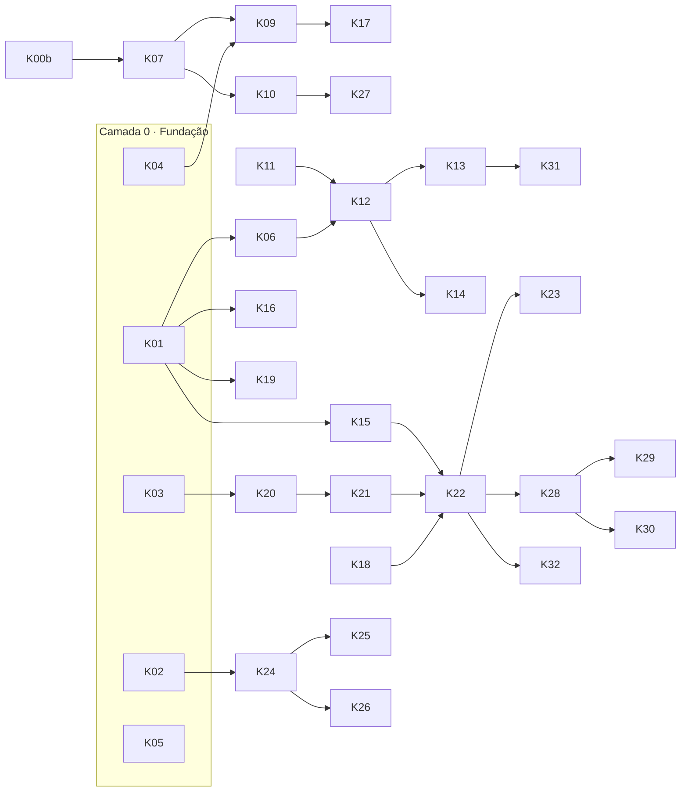

# Kanban — Torralles Studio

> Atualizado em 16/10/2026. Cada cartão aponta para a spec que o define (`docs/sdd/`).
> Fluxo de cada cartão: **Backlog → Especificado → Em andamento → Em verificação → Pronto**.

## Regras do quadro
- **Pronto para começar** (Especificado): tem spec, critérios de aceite e dependências resolvidas.
- **Pronto de verdade** (Pronto): testes passando, critérios de aceite cumpridos e **verificado por um agente diferente de quem fez** (protocolo, fase 7). Reprovado → volta para "Em andamento" com o feedback.
- **No máximo 3 cartões em andamento** ao mesmo tempo; cartões da mesma camada sem dependência entre si podem rodar em paralelo.
- Bloqueios ficam marcados com 🔒 e o que falta.
- Toda decisão nova vai para `docs/sdd/decisoes.md`; aprendizados de cada fase vão para o Cérebro (D16).

---

## ✅ Pronto
| ID | Cartão | Spec |
|---|---|---|
| K00a | Roteador com fallback por função, provedores e CLI (protótipo) | — |
| K00b | Percepção níveis 1 e 2: quadros, cortes, som, transcrição com fallback | [10](docs/sdd/10-percepcao.md) |
| K00c | Planejamento: specs 00–12 e decisões D1–D20 | [decisões](docs/sdd/decisoes.md) |
| K01 | Modelos atualizados + Kling v3 `start_image_url` (teste de contrato por família) | [00](docs/sdd/00-descoberta.md) |
| K02 | Pacote renomeado para `torralles_studio` | D1 |
| K03 | Downloads seguros: domínios permitidos, redirecionamento conferido antes de seguir, limite de tamanho e prazo total | [05](docs/sdd/05-dados-seguranca-memoria.md) · D8 |
| K04 | Chaves mascaradas + teto de custo de US$ 1,50 | D8 · D20 |
| K05 | `CLAUDE.md` do projeto | [05](docs/sdd/05-dados-seguranca-memoria.md) |
| K07 | Avaliador na régua 0–100: eliminatórios, pesos, pisos, juízes de outra família, desempate | [03](docs/sdd/03-parametros-avaliacao.md) · D15 |
| K08 | Checador de fatos travados (preço, link, percentual, obrigatórios) | [08](docs/sdd/08-contrato-ops-studio.md) · D15 |
| K10 | Relatório de qualidade e custo por peça (JSON) | [01](docs/sdd/01-controle-qualidade.md) |
| K09 | Loop de correção: refaz só a peça, feedback delimitado, limites, teto de custo, melhor tentativa | [01](docs/sdd/01-controle-qualidade.md) |
| K24 | SQLite: projetos, peças, tentativas, avaliações, custo; retomada sem pagar de novo e cache | [05](docs/sdd/05-dados-seguranca-memoria.md) · D6 |
| K26 | Perfis por projeto que não se misturam (estilo, voz, formato, kit visual, memória; ligação com o Hermes) | D11 · D13 |

## 🔍 Em verificação
_(vazio)_

## 🛠️ Em andamento
_(vazio)_

## 📋 Especificado (pronto para começar)

### Camada 0 — Fundação
✅ Concluída em 16/10/2026 (verificada por agente independente; ver `docs/sdd/aprendizados.md`).

### Camada 1 — Qualidade (depende da Camada 0)
K07–K10 prontos em 16/10/2026. Falta só o K06 (roda no PC, com a chave do Gemini).

| ID | Cartão | Spec | Depende de | Critérios de aceite |
|---|---|---|---|---|
| K06 | 🔒 Juiz que assiste o vídeo inteiro (Gemini, vídeo + áudio, também por link do YouTube) | [10](docs/sdd/10-percepcao.md) | K01 · **falta `GEMINI_API_KEY`** | Devolve JSON na régua 0–100; testado com `exemplos/demo_torralles_studio_v2.mp4` |

### Camada 2 — Referências (D17; corre em paralelo à Camada 1)
| ID | Cartão | Spec | Depende de | Critérios de aceite |
|---|---|---|---|---|
| K11 | 🔒 Escolher canais e vídeos de referência (5 bons + 2 ruins por categoria; começa pela A) | [09](docs/sdd/09-referencias-qualidade.md) · [12](docs/sdd/12-pesquisa-qualidade-concorrentes.md) | **sua aprovação da lista** | Lista aprovada no repositório |
| K12 | `analisar_referencia(url)`: métricas + estrutura do roteiro + 4 critérios de potencial | [12](docs/sdd/12-pesquisa-qualidade-concorrentes.md) | K06 · K11 | Analisa por link, sem baixar; JSON por vídeo |
| K13 | Perfis de referência por categoria (faixas 25º–75º) substituindo números da spec 03 | [09](docs/sdd/09-referencias-qualidade.md) | K12 | `config` com faixas medidas; spec 03 atualizada |
| K14 | Calibração: suas notas × notas dos juízes nas referências | [03](docs/sdd/03-parametros-avaliacao.md) | K07 · K12 | Divergência medida; âncoras ajustadas |

### Camada 3 — Produção (depende das Camadas 0 e 1)
| ID | Cartão | Spec | Depende de | Critérios de aceite |
|---|---|---|---|---|
| K15 | Roteiro em JSON com clima e sons por cena | [03](docs/sdd/03-parametros-avaliacao.md) | K01 · K07 | Validado por esquema e pela régua |
| K16 | Pesquisa com fontes (Tavily) e checagem de citações | [03](docs/sdd/03-parametros-avaliacao.md) | K01 | Citações sempre apontam para fontes reais |
| K17 | 🔒 Imagens com consistência entre cenas (Nano Banana 2 / FLUX) | [03](docs/sdd/03-parametros-avaliacao.md) | K01 · K09 · **chaves** | Juízes aprovam consistência e anatomia |
| K18 | 🔒 Voz com fallback (ElevenLabs → Gemini TTS → Edge → Piper) e checagem por transcrição | [11](docs/sdd/11-banco-midia-gratuita.md) | K00b · **chaves** | Erro de palavras ≤ 10% |
| K19 | 🔒 Vídeo por cena no modo misto (Kling v3 nas cenas-chave, zoom nas demais) | D20 | K01 · K04 · **chave fal.ai** | Custo dentro do teto; sem congelamento indevido |
| K20 | Mídia em 3 camadas: acervo local + Pexels/Pixabay/Freesound/Openverse, com licença por arquivo | [11](docs/sdd/11-banco-midia-gratuita.md) · D18 | K03 | Licenças bloqueadas são recusadas; créditos gerados |
| K21 | Escolha de trilha pela pontuação da spec 12 (BPM e energia com librosa) | [12](docs/sdd/12-pesquisa-qualidade-concorrentes.md) · D19 | K20 · K06 | Trilha com letra durante a fala é eliminada |
| K22 | Montagem final: transições no tempo da música, legendas sincronizadas, trilha abaixando sob a voz (≥ 10 LU), −14 LUFS | [03](docs/sdd/03-parametros-avaliacao.md) · [12](docs/sdd/12-pesquisa-qualidade-concorrentes.md) | K15 · K18 · K21 | Percepção confirma volume, sincronia e área segura |
| K23 | Exportação para CapCut (pasta com clipes, áudios e legendas) | D5 | K22 | Abre no CapCut sem retrabalho |

### Camada 4 — Dados e memória (pode começar junto com a Camada 1)
| ID | Cartão | Spec | Depende de | Critérios de aceite |
|---|---|---|---|---|
| K25 | Biblioteca por hash com licença e busca por etiqueta | [05](docs/sdd/05-dados-seguranca-memoria.md) | K24 | Sem duplicatas; licença obrigatória |
| K27 | Exportar aprendizados para o Cérebro | D16 | K10 | Resumo gerado no formato do Cérebro |

### Camada 5 — Integração (depende das Camadas 1, 3 e 4)
| ID | Cartão | Spec | Depende de | Critérios de aceite |
|---|---|---|---|---|
| K28 | Servidor MCP + HTTP local, assíncrono (`POST /v1/pecas`, `GET /v1/pecas/{id}`) | [08](docs/sdd/08-contrato-ops-studio.md) · D13 · D14 | K22 · K24 | Exemplo real do Ops validado pelo esquema |
| K29 | No Torralles Ops (outro repositório): botão "Produzir no Studio" + colunas novas | [08](docs/sdd/08-contrato-ops-studio.md) | K28 | Peça volta com arquivo, nota e custo |
| K30 | Hermes: skill/perfil que chama o Studio | [06](docs/sdd/06-estudo-hermes.md) | K28 | Pedido pelo Hermes gera vídeo |

### Camada 6 — Validação
| ID | Cartão | Spec | Depende de | Critérios de aceite |
|---|---|---|---|---|
| K31 | Teste prático do benchmark (3 briefings, mesma régua para todos) | [04](docs/sdd/04-benchmark.md) | K22 · K13 | Relatório comparativo |
| K32 | Primeiro vídeo real ponta a ponta, **aprovado por você** | D19 | K22 · K09 | Você aprova o vídeo completo |

## 🔁 Recorrentes
| ID | Cartão | Frequência |
|---|---|---|
| KR1 | Verificar modelos, preços e limites gratuitos dos provedores | Mensal |
| KR2 | Recalibrar juízes ao trocar um modelo ou a cada mês | Mensal |

---

## Ordem e paralelismo

## Bloqueios atuais
| O que falta | Destrava |
|---|---|
| `GEMINI_API_KEY` no ambiente (Network secrets) | K06, K12, K21 (ouvir trilhas) |
| Sua aprovação da lista de canais de referência | K11 → K12, K13, K14 |
| Chaves de produção (fal.ai, ElevenLabs, DeepSeek, Tavily) | K16–K19 com provedores reais |
